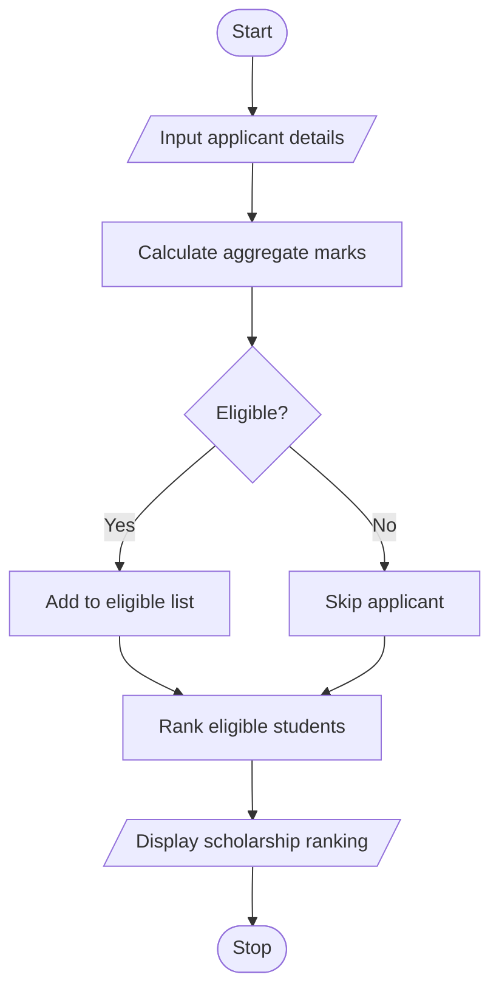

# University Scholarship Allocation System in Python

## 1. Problem Statement

Develop a menu-driven Python program to allocate university scholarships based on students' aggregate marks, subject-wise minimum marks, attendance percentage, and family income. The program identifies eligible students, ranks them according to aggregate marks, and resolves ties using attendance percentage and lower family income. Finally, it displays the ranked list of eligible students.

Eligibility criteria (example):

- Aggregate marks: at least 75%.
- Minimum score in every subject: 60 marks out of 100.
- Attendance: at least 75%.
- Annual family income: not more than ₹2,50,000.
- Tie-breaking: higher aggregate marks, then higher attendance, then lower family income.

These are sample rules for the program and can be changed according to university policy.

## 2. Algorithm

1. Start the program.
2. Read the number of scholarship applicants.
3. For each applicant, input the name, subject marks, attendance, and annual family income.
4. Calculate aggregate percentage from the subject marks.
5. Check all scholarship eligibility conditions.
6. Store eligible applicants in a list.
7. Sort eligible applicants by aggregate percentage in descending order.
8. If aggregate marks are equal, rank higher attendance first.
9. If both are equal, rank lower family income first.
10. Display the ranked list of eligible students.
11. If no students qualify, display an appropriate message.
12. Stop the program.

## 3. Flowchart using Mermaid



## 5. Sample Input

Number of applicants: 3

Student name: Ravi
Enter 3 subject marks: 90 80 85
Attendance (%): 90
Annual family income: ₹200000

Student name: Priya
Enter 3 subject marks: 90 80 85
Attendance (%): 95
Annual family income: ₹220000

Student name: Aman
Enter 3 subject marks: 70 80 75
Attendance (%): 80
Annual family income: ₹250000

## 6. Sample Output

```
Scholarship Ranking
1 Priya Aggregate: 85.0 Attendance: 95.0 Income: 220000
2 Ravi Aggregate: 85.0 Attendance: 90.0 Income: 200000
3 Aman Aggregate: 75.0 Attendance: 80.0 Income: 250000
```


