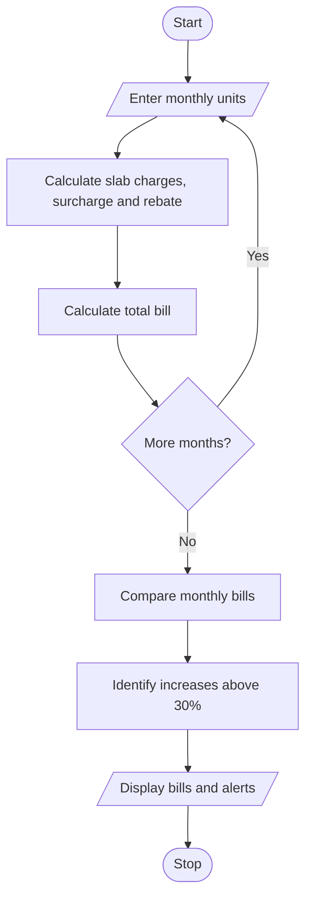

# Progressive Electricity Billing System in Python

## 1. Problem Statement

Develop a Python program to calculate household electricity bills using progressive consumption slabs, fixed charges, surcharges, and rebates. Compare bills across multiple months and identify unusual increases in electricity costs.

Sample billing rules:

- First 100 units: ₹2 per unit
- Next 100 units: ₹3 per unit
- Above 200 units: ₹5 per unit
- Fixed charge: ₹50 per month
- Surcharge: 5% of energy charges
- Rebate: 10% of energy charges if consumption is below 100 units
- Unusual increase: current bill increases by more than 30% compared with the previous month.

## 2. Algorithm

1. Start the program.
2. Input the number of months.
3. For each month, enter electricity consumption in units.
4. Calculate energy charges using progressive slabs.
5. Add fixed charges and surcharge.
6. Apply the rebate if eligible.
7. Compare the current bill with the previous month's bill.
8. Identify increases greater than 30%.
9. Display monthly bills and unusual increases.
10. Stop.

## 3. Flowchart 

## 5. Sample Input

Enter number of months: 3
Month 1 units: 80
Month 2 units: 120
Month 3 units: 250

## 6. Sample Output

Month 1 bill: ₹201.60
Month 2 bill: ₹365.00
Unusual increase detected!
Month 3 bill: ₹1062.50
Unusual increase detected!
Billing completed.

