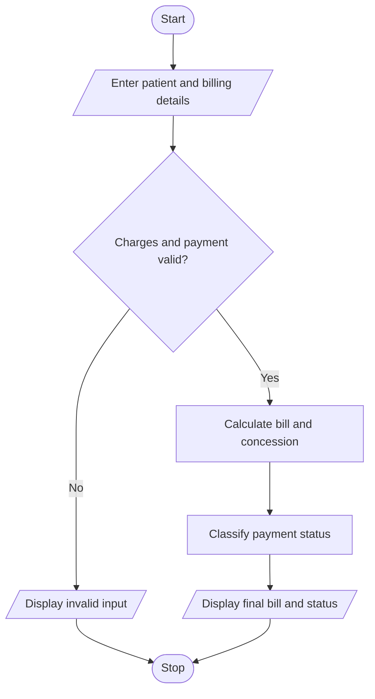

# Hospital Billing and Patient Classification in Python

## 1. Problem Statement

Hospital Billing and Patient Classification: Process consultation, diagnostic, and treatment charges, apply conditional concessions, validate billing constraints, and classify patients according to a supplied payment policy

## 2. Algorithm

1. Start.
2. Input patient name, age, and payment amount.
3. Input consultation, diagnostic, and treatment charges.
4. Validate that charges and payment are non-negative.
5. Calculate the total bill.
6. Apply a 10% concession for senior citizens aged 60 or above.
7. Calculate the final bill.
8. Classify the patient's payment status.
9. Display the bill and payment classification.
10. Stop.

## 3. Flowchart

## 5. Sample Input

Patient name: Ravi
Age: 65
Consultation charge: 500
Diagnostic charge: 1000
Treatment charge: 3000
Payment amount: 2000

## 6. Sample Output

Total bill: ₹ 4500.0
Concession: ₹ 450.0
Final bill: ₹ 4050.0
Balance: ₹ 2050.0
Status: Partially Paid

