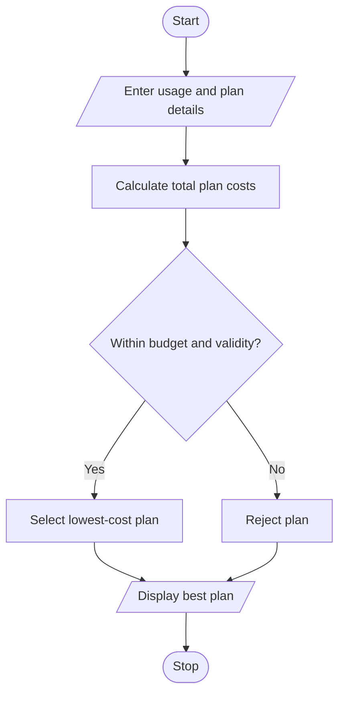

# Multi-Plan Telecommunications Cost Optimization in Python

## 1. Problem Statement
 Multi-Plan Telecommunications Cost Optimization: Evaluate several mobile plans against usage, validity, and budget constraints; calculate excess charges and identify the most economical eligible plan. 

## 2. Algorithm

1. Start.
2. Input required data usage, call minutes, validity, and budget.
3. Enter the details of multiple mobile plans.
4. Calculate excess data and call charges for each plan.
5. Calculate each plan's total cost.
6. Check validity and budget constraints.
7. Select the lowest-cost eligible plan.
8. Display the plan costs and the best plan.
9. If no plan qualifies, display a suitable message.
10. Stop.

## 3. Flowchart 

## 5. Sample Input

Required data (GB): 3
Required call minutes: 200
Required validity (days): 28
Budget: ₹300
Number of plans: 3

Plan 1
Plan name: Basic
Base price: ₹199
Included data (GB): 2
Included call minutes: 100
Validity (days): 28

Plan 2
Plan name: Smart
Base price: ₹249
Included data (GB): 3
Included call minutes: 250
Validity (days): 28

Plan 3
Plan name: Value
Base price: ₹299
Included data (GB): 5
Included call minutes: 300
Validity (days): 56

## 6. Sample Output

Total cost: ₹309.00 Not eligible
Total cost: ₹249.00 Eligible
Total cost: ₹299.00 Eligible

Best plan: Smart, Cost: ₹249.00

