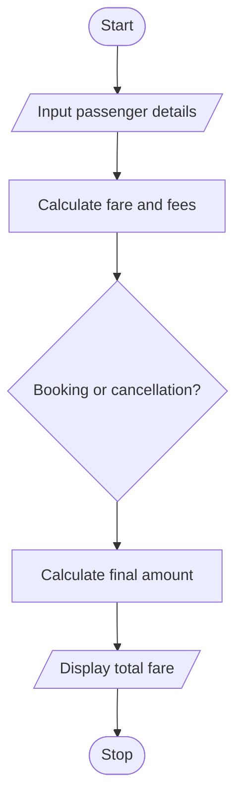

# Railway Fare and Reservation Calculator in Python

## 1. Problem Statement
 Railway Fare and Reservation Calculator: Calculate fares for multiple passengers using distance slabs, travel classes, age-based concessions, reservation fees, and specified cancellation penalties. 
## 2. Algorithm

1. Start.
2. Input the number of passengers and travel distance.
3. For each passenger, input name, age, travel class, and booking or cancellation choice.
4. Calculate the base fare using distance slabs.
5. Apply the travel class multiplier and age concession.
6. Add reservation fees for bookings or apply cancellation penalties for cancellations.
7. Display each passenger's fare.
8. Calculate and display the total amount.
9. Stop.

## 3. Flowchart 

## 5. Sample Input

Number of passengers: 4
Travel distance (km): 250

Passenger 1
Name: Ravi
Age: 65
Class (Sleeper/AC): Sleeper
Action (Book/Cancel): Book

Passenger 2
Name: Priya
Age: 35
Class (Sleeper/AC): AC
Action (Book/Cancel): Book

Passenger 3
Name: Aman
Age: 4
Class (Sleeper/AC): Sleeper
Action (Book/Cancel): Book

Passenger 4
Name: Sita
Age: 30
Class (Sleeper/AC): AC
Action (Book/Cancel): Cancel

## 6. Sample Output

Ravi: Booking fare = ₹560.00
Priya: Booking fare = ₹1340.00
Aman: Booking fare = ₹40.00
Sita: Cancellation penalty = ₹325.00

Total booking amount: ₹1940.00
Total cancellation penalties: ₹325.00

