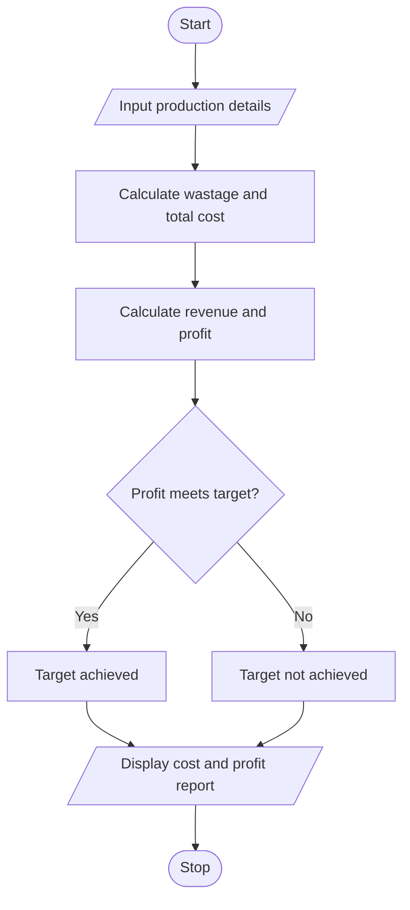

# Manufacturing Cost and Profitability Analysis in Python

## 1. Problem Statement
 Manufacturing Cost and Profitability Analysis: Calculate material costs, labour charges, wastage, machine costs, and selling prices; identify whether production meets a specified profit target

## 2. Algorithm

1. Start.
2. Input material cost, labour charges, machine costs, wastage percentage, quantity produced, selling price per unit, and target profit.
3. Calculate wastage cost.
4. Calculate total manufacturing cost.
5. Calculate total selling revenue.
6. Calculate profit.
7. Compare profit with the target.
8. Display total cost, revenue, profit, and target status.
9. Stop.

## 3. Flowchart 

     

## 5. Sample Input

Material cost: ₹10000
Labour charges: ₹4000
Machine cost: ₹2000
Wastage percentage: 5
Quantity produced: 100
Selling price per unit: ₹200
Target profit: ₹3000

## 6. Sample Output

--- PRODUCTION REPORT ---
Wastage cost: ₹500.00
Total cost: ₹16500.00
Sales revenue: ₹20000.00
Profit: ₹3500.00
Target achieved

